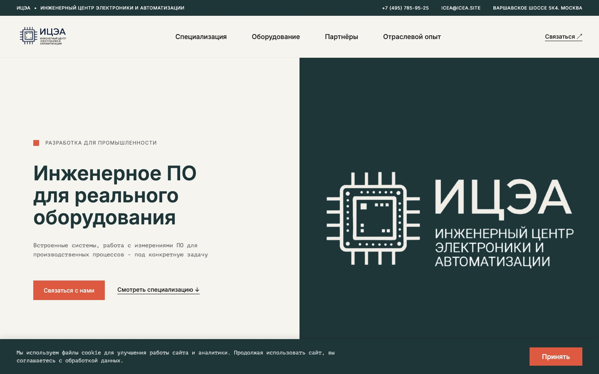
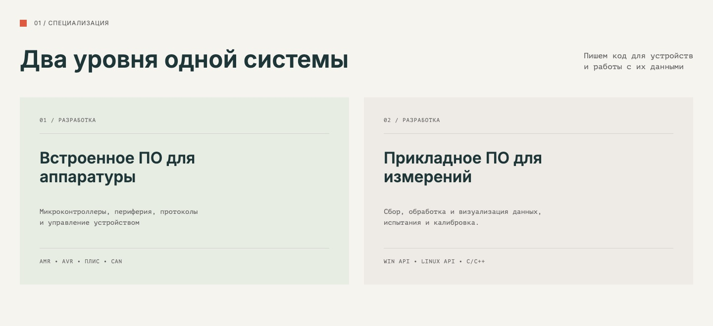
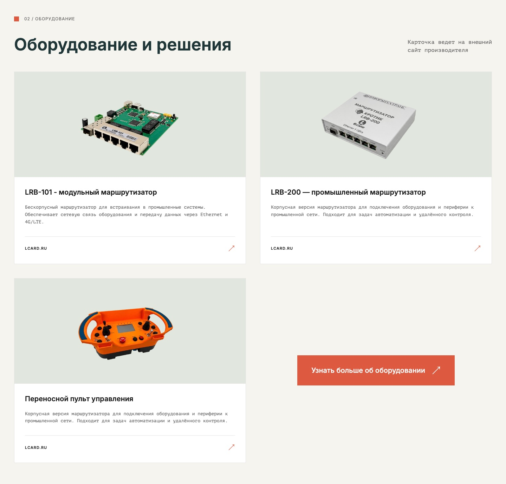
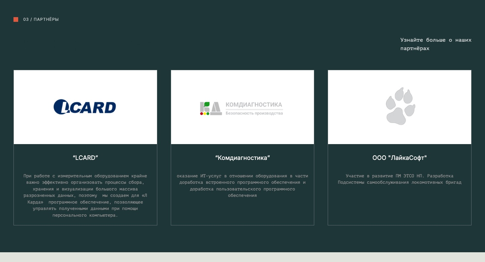
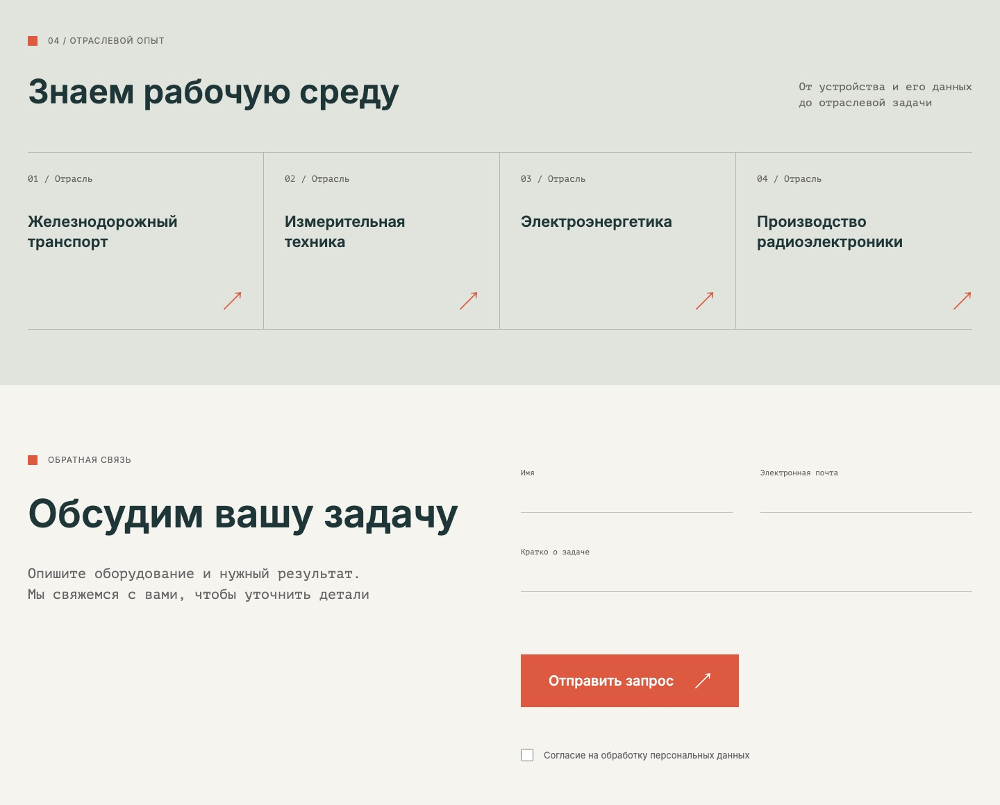

# ИЦЭА — корпоративный сайт инженерного центра

Сайт ООО «Инженерный центр электроники и автоматизации» (icea.site). Сделан с нуля во время производственной практики: дизайн в Figma, логотип в Adobe Illustrator, адаптивная вёрстка, JavaScript-логика и серверная часть на PHP + MySQL.



## Возможности

- Адаптивная кроссбраузерная вёрстка на Flexbox и CSS Grid, фиксированная навигация
- Разделы «Специализация», «Оборудование», «Партнёры», «Отраслевой опыт», карта Google Maps
- Форма обратной связи с валидацией и отправкой без перезагрузки страницы (Fetch API)
- Заявки сохраняются в MySQL через PDO с подготовленными запросами (защита от SQL-инъекций), входные данные экранируются `htmlspecialchars`, обработчик принимает только POST-запросы
- Баннер согласия на cookie: согласие хранится 30 дней

## Скриншоты

| Специализация | Оборудование |
| --- | --- |
|  |  |
| **Партнёры** | **Отраслевой опыт и форма заявки** |
|  |  |

## Стек

HTML5 · CSS3 · JavaScript · PHP 8 · MySQL · Figma · Adobe Illustrator

## Запуск локально

1. Установите MAMP (или XAMPP / OpenServer) и положите папку проекта в `htdocs`.
2. В phpMyAdmin создайте базу `ICEA` и импортируйте файл `ICEA.sql`.
3. Проверьте параметры подключения в `process.php` (по умолчанию MAMP: `root` / `root`).
4. Откройте `http://localhost:8888/icea/`.

## Структура

```
index.html      — разметка сайта и клиентский JavaScript
style.css       — стили и адаптивность
process.php     — обработчик формы обратной связи
ICEA.sql        — структура и данные базы
img/            — изображения
```

Автор: Ксения Тихонова — [github.com/ksuwld](https://github.com/ksuwld)
